The Raw Data are the four files: diatoms.csv, fish.csv, invertebrates.csv, and macrophytes.csv available on Zenodo.
All files we have made available are marked with an * at the end of their name.
Some files have a placeholder \*taxon\* in their name. These files exist separately for each taxon and are called e.g., 01_diatoms_w_catchment_id.rds.

We recommend copy pasting the diagram [here](https://mermaidviewer.com/editor). This website allows interactive exploration of mermaid diagrams. 

 

Legend:
- 📜 analysis script
- ⚙️ custom scripts/functions (dashed arrow: sourced by a script)
- 📄 file (typically .rds)
- 📁 directory; often referring to all files in the respective directory
- 🖼️ figure (.png/.tif)
- 📊 table (.docx)

```mermaid
flowchart LR

    %% 1. Define custom colors for each type
    classDef script fill:#E1F5FE,stroke:#0288D1,stroke-width:2px,color:#000
    classDef helper fill:#B3E5FC,stroke:#0288D1,stroke-width:2px,color:#000
    classDef file fill:#E8F5E9,stroke:#388E3C,stroke-width:2px,color:#000
    classDef folder fill:#FFF9C4,stroke:#FBC02D,stroke-width:2px,color:#000
    classDef figure fill:#FCE4EC,stroke:#C2185B,stroke-width:2px,color:#000
    classDef table fill:#F3E5F5,stroke:#7B1FA2,stroke-width:2px,color:#000

    %% 2. Define nodes per pipeline stage
    %%    Scripts & helpers: stadium | Files: rectangle | Folders: parallelogram | Figures & tables: flag

    subgraph sg_data_prep["data_prep"]
        %% Scripts
        S1(["📜 01_add_eu_hydro_to_biota.R"]):::script
        S2(["📜 02_combine_env.R"]):::script
        S3(["📜 03_add_env_biota.R"]):::script
        S4(["📜 04_define_schemes.R"]):::script
        %% Files
        F1["📄 all_catchments_w_environment.rds"]:::file
        F2["📄 eu_hydro_dem_w_enz.rds"]:::file
        F3["📄 01_*taxon*_w_catchment_id.rds"]:::file
        F4["📄 02_*taxon*_w_environment.rds"]:::file
        F5["📄 03_*taxon*_scheme.rds"]:::file
        %% Folders
        D1[/"📁 catchments_w_environment"/]:::folder
        D2[/"📁 parquet_catchments"/]:::folder
        D3[/"📁 MIDFIRE data"/]:::folder
        D4[/"📁 env_data"/]:::folder
    end

    subgraph sg_supplement_S1["supplement_S1"]
        %% Scripts
        S5(["📜 S1_rebuild_env_for_coverage_check.R"]):::script
        S6(["📜 S1_MESS_environments.R"]):::script
        S7(["📜 S1_MESS_interpretation.R"]):::script
        %% Helpers
        H1(["⚙️ coverage_metrics.R"]):::helper
        H2(["⚙️ find_max_consequtive_sum.R"]):::helper
        H3(["⚙️ scheme_rules.R"]):::helper
        %% Files
        F6["📄 new_environment.rds"]:::file
        F7["📄 coverage_per_catchment_*taxon*.rds"]:::file
        %% Folders
        D5[/"📁 areas"/]:::folder
        %% Figures
        P1>"🖼️ Figure S1"]:::figure
    end

    subgraph sg_supplement_S2["supplement_S2"]
        %% Scripts
        S8(["📜 compile_stressors.R"]):::script
        S9(["📜 S1_simplify_catchments.R"]):::script
        S10(["📜 S2_LD_type_coherence.R"]):::script
        S11(["📜 S2_subset_coverage.R"]):::script
        S12(["📜 S2_plot_subset_coverage.R"]):::script
        S13(["📜 S2_pressure_gradient_representation"]):::script
        %% Files
        F8["📄 all_eu_hydro_dem_catchments_simplified_250m.rds"]:::file
        F9["📄 PCA_stressors.rds"]:::file
        F10["📄 subset_coverage_per_catchment_*group*.rds"]:::file
        F11["📄 subset_coverage_summary.csv"]:::file
        F12["📄 subset_coverage.rds"]:::file
        %% Folders
        D6[/"📁 pressure data sets"/]:::folder
        %% Figures
        P2>"🖼️ Figure S13"]:::figure
        P3>"🖼️ Figure S5"]:::figure
        P4>"🖼️ Figure S6"]:::figure
        P5>"🖼️ Figure S7"]:::figure
        P6>"🖼️ Figure S8"]:::figure
        P7>"🖼️ Figure S9"]:::figure
    end

    subgraph sg_Case_study["Case study"]
        %% Scripts
        S14(["📜 prepare_for_app.R"]):::script
        S15(["📜 app.R"]):::script
        S16(["📜 prepare_brt_fish.R"]):::script
        %% Files
        F13["📄 m_river_fec_broad_type.shp"]:::file
        F14["📄 S2_pulse_batch_all_results_LD.csv"]:::file
        F15["📄 brt_fish_community.csv"]:::file
        F16["📄 brt_fish_env.csv"]:::file
        F17["📄 brt_fish_sites.csv"]:::file
        F18["📄 pulse_predictors.csv"]:::file
        F19["📄 pulse_coherence.csv"]:::file
        F20["📄 pulse_batch.csv"]:::file
    end

    subgraph sg_hmsc["hmsc"]
        %% Scripts
        S17(["📜 construct_date_variables.R"]):::script
        S18(["📜 05_build_hmsc_hpc_models.R"]):::script
        S19(["📜 06_hmsc_array.sh"]):::script
        S20(["📜 07_evaluate_model_fit.R"]):::script
        S21(["📜 08_variation_partitioning.R"]):::script
        %% Helpers
        H4(["⚙️ c_score.R"]):::helper
        H5(["⚙️ site_occupancy.R"]):::helper
        H6(["⚙️ gelman_check.R"]):::helper
        H7(["⚙️ determine_spatial_scale.R"]):::helper
        H8(["⚙️ remove_collinearity.R"]):::helper
        H9(["⚙️ extract_coordinates.R"]):::helper
        %% Files
        F21["📄 *taxon*_date_variables.rds"]:::file
        %% Folders
        D7[/"📁 001_unfitted_hmsc_models"/]:::folder
        D8[/"📁 002_initialized_hmsc_models"/]:::folder
        D9[/"📁 003_fitted_hmsc_models"/]:::folder
        D10[/"📁 004_model_fit"/]:::folder
        D11[/"📁 005_variation_partitioning"/]:::folder
        D12[/"📁 site_coordinates"/]:::folder
        D13[/"📁 spatial_scale"/]:::folder
        D14[/"📁 taxonomic_resolution"/]:::folder
        D15[/"📁 taxa_counts"/]:::folder
        D16[/"📁 unscaled_environments"/]:::folder
    end

    subgraph sg_simulation["simulation"]
        %% Scripts
        S22(["📜 09_simulate_data.R"]):::script
        %% Helpers
        H10(["⚙️ shift_types.R"]):::helper
        H11(["⚙️ typology_tools.R"]):::helper
        %% Folders
        D17[/"📁 006_simulated_data"/]:::folder
        D18[/"📁 simulation_diagnostics"/]:::folder
    end

    subgraph sg_evaluation["evaluation"]
        %% Scripts
        S23(["📜 10_evaluate_typologies.R"]):::script
        S24(["📜 10_evaluate_empirical_updated.R"]):::script
        %% Helpers
        H12(["⚙️ calculate_auc.R"]):::helper
        H13(["⚙️ exact_zeta.R"]):::helper
        H14(["⚙️ render_table.R"]):::helper
        %% Folders
        D19[/"📁 007_evaluations"/]:::folder
        D20[/"📁 007_evaluations_originals"/]:::folder
    end

    subgraph sg_qrf["qrf"]
        %% Scripts
        S25(["📜 11_qrf_fit.R"]):::script
        S26(["📜 13_qrf_summary.R"]):::script
        %% Files
        F22["📄 *run*_run_info.rds"]:::file
        F23["📄 *run*_split.rds"]:::file
        F24["📄 *run*_tuning.rds"]:::file
        F25["📄 *run*.rds"]:::file
        F26["📄 *run*_metrics.rds"]:::file
        F27["📄 *run*_intervals.rds"]:::file
        F28["📄 *run*_quantile_importance.rds"]:::file
        F29["📄 *run*_ale.rds"]:::file
        F30["📄 *run*_datasets.rds"]:::file
        F31["📄 *run*_lofo.rds"]:::file
        F32["📄 ale_summary.csv"]:::file
        F33["📄 ale_additivity.csv"]:::file
        F34["📄 importance_tail_vs_centre.csv"]:::file
        F35["📄 dataset_influence.csv"]:::file
        F36["📄 dataset_influence_summary.csv"]:::file
        F37["📄 weighting_pooled_vs_per_dataset.csv"]:::file
        F38["📄 dataset_concentration.csv"]:::file
        F39["📄 lofo_calibration.csv"]:::file
        F40["📄 importance_crps_cv.csv"]:::file
        F41["📄 lofo_contrast.csv"]:::file
        F42["📄 summary_tables.rds"]:::file
    end

    subgraph sg_supplement_S6["supplement_S6"]
        %% Scripts
        S27(["📜 12_combine_evaluations.R"]):::script
        S28(["📜 S6_FIGURES.R"]):::script
        S29(["📜 S6_PLOT_TypeCoherenceOBSvsSIM.R"]):::script
        S30(["📜 S6_PLOT_gamma_and_p.R"]):::script
        S31(["📜 create_coherence_original.R"]):::script
        S32(["📜 figure31_data_rev1.R"]):::script
        %% Files
        F43["📄 combined_data.rds"]:::file
        F44["📄 simulation_results_key_metrics.rds"]:::file
        F45["📄 coherence_original.rds"]:::file
        %% Figures
        P8>"🖼️ Figure S19"]:::figure
        P9>"🖼️ Figure S20"]:::figure
        P10>"🖼️ Figure S21"]:::figure
        P11>"🖼️ Figure S22"]:::figure
        P12>"🖼️ Figure S23"]:::figure
    end

    subgraph sg_supplement_S7["supplement_S7"]
        %% Scripts
        S33(["📜 S7_ALE.R"]):::script
        S34(["📜 S7_DataSet_CRPS_FIGURE.R"]):::script
        S35(["📜 S7_DataSet_effectiveSize_TABLE.r"]):::script
        S36(["📜 S7_FIGURE_LOFO.R"]):::script
        S37(["📜 S7_QRF_TUNING_TABLE.R"]):::script
        S38(["📜 S7_QRF_PREDICTOR_TABLE_.R"]):::script
        S39(["📜 S7_TAIL_FILES.R"]):::script
        S40(["📜 S7_TAIL_PLOT.R"]):::script
        %% Files
        F46["📄 S7_importance_by_tau.csv"]:::file
        F47["📄 S7_importance_by_band.csv"]:::file
        %% Figures
        P13>"🖼️ Figure S24"]:::figure
        P14>"🖼️ Figure S25"]:::figure
        P15>"🖼️ Figure S26"]:::figure
        P16>"🖼️ Figure S27"]:::figure
        P17>"🖼️ Figure S28"]:::figure
        %% Tables
        T1>"📊 S7_DataSet_effectiveSize_table.docx"]:::table
        T2>"📊 S7_qrf_predictor_table.docx"]:::table
        T3>"📊 S7_QRF_TUNING_table.docx"]:::table
    end

    subgraph sg_results["results"]
        %% Scripts
        S41(["📜 res_4.r"]):::script
        S42(["📜 res_5.r"]):::script
        %% Figures
        P18>"🖼️ Figure 8"]:::figure
        P19>"🖼️ Figure 3"]:::figure
        P20>"🖼️ Figure 4"]:::figure
        P21>"🖼️ Figure 5"]:::figure
        P22>"🖼️ Figure 6"]:::figure
        P23>"🖼️ Figure 7"]:::figure
    end

    subgraph sg_Shiny["Shiny"]
        %% Scripts
        S43(["📜 summarize_reduction.R"]):::script
        S44(["📜 test_reduced_forest.R"]):::script
        S45(["📜 reduce_forest_size.R"]):::script
        %% Folders
        D21[/"📁 reduction_tests"/]:::folder
        D22[/"📁 models"/]:::folder
        D23[/"📁 small_models"/]:::folder
    end

    subgraph sg_supplement_S8["supplement_S8"]
        %% Figures
        P24>"🖼️ Figure S29"]:::figure
    end

    subgraph sg_supplement_S5["supplement_S5"]
        %% Scripts
        S46(["📜 S5.R"]):::script
        S47(["📜 S5_MAP.R"]):::script
        %% Figures
        P25>"🖼️ Figure S14"]:::figure
        P26>"🖼️ Figure S15"]:::figure
        P27>"🖼️ Figure S16"]:::figure
        P28>"🖼️ Figure S17"]:::figure
        P29>"🖼️ Figure S18"]:::figure
    end

    %% 3. Connections per pipeline stage (inputs, then outputs)

    %% data_prep
    D3 --> S1
    D2 --> S1
    D4 --> S2
    F3 --> S3
    D1 --> S3
    F4 --> S4
    F2 --> S4
    H2 -.-> S4
    S1 --> F3
    S2 --> D1
    S3 --> F4
    S4 --> F5

    %% supplement_S1
    F5 --> S5
    F4 --> S5
    D11 --> S5
    F6 --> S6
    F9 --> S6
    F7 --> S7
    F6 --> S7
    F1 --> S7
    F9 --> S7
    S5 --> F6
    S6 --> F7
    S7 --> P1

    %% supplement_S2
    D2 --> S9
    F1 --> S11
    D5 --> S11
    F6 --> S11
    F9 --> S11
    F4 --> S11
    H2 -.-> S11
    H3 -.-> S11
    H1 -.-> S11
    F4 --> S10
    F9 --> S10
    F13 --> S10
    F14 --> S10
    S14 -.-> S10
    F9 --> S13
    F4 --> S13
    F11 --> S12
    F8 --> S12
    D6 --> S8
    S9 --> F8
    S11 --> F10
    S11 --> F11
    S11 --> F12
    S10 --> P2
    S13 --> P5
    S12 --> P6
    S12 --> P7
    S8 --> P3
    S8 --> P4
    S8 --> F9

    %% Case study
    F13 --> S16
    D3 --> S16
    F4 --> S16
    F15 --> S14
    F16 --> S14
    F17 --> S14
    F18 --> S15
    F19 --> S15
    F20 --> S15
    S16 --> F15
    S16 --> F16
    S16 --> F17
    S15 --> F14
    S14 --> F18
    S14 --> F19
    S14 --> F20
    S15 --> P18

    %% hmsc
    F4 --> S18
    F5 --> S18
    H7 -.-> S18
    H8 -.-> S18
    H9 -.-> S18
    D8 --> S19
    D7 --> S20
    D9 --> S20
    D13 --> S20
    H6 -.-> S20
    H4 -.-> S20
    H5 -.-> S20
    D7 --> S21
    D9 --> S21
    D10 --> S21
    F5 --> S17
    F4 --> S17
    D11 --> S17
    S18 --> D7
    S18 --> D8
    S18 --> D15
    S18 --> D13
    S18 --> D12
    S18 --> D14
    S18 --> D16
    S19 --> D9
    S20 --> D10
    S21 --> D11
    S17 --> F21

    %% simulation
    F2 --> S22
    F5 --> S22
    D7 --> S22
    D9 --> S22
    D10 --> S22
    D11 --> S22
    D16 --> S22
    D12 --> S22
    H10 -.-> S22
    H11 -.-> S22
    S22 --> D17
    S22 --> D18

    %% evaluation
    D17 --> S23
    D13 --> S23
    H14 -.-> S23
    H12 -.-> S23
    H13 -.-> S23
    D17 --> S24
    D13 --> S24
    D7 --> S24
    D12 --> S24
    H14 -.-> S24
    H12 -.-> S24
    H13 -.-> S24
    S23 --> D19
    S24 --> D20

    %% qrf
    D19 --> S25
    D13 --> S25
    D14 --> S25
    F21 --> S25
    D17 --> S25
    F22 --> S26
    F23 --> S26
    F24 --> S26
    F26 --> S26
    F27 --> S26
    F28 --> S26
    F29 --> S26
    F30 --> S26
    F31 --> S26
    S25 --> F22
    S25 --> F23
    S25 --> F24
    S25 --> F25
    S25 --> F26
    S25 --> F27
    S25 --> F28
    S25 --> F29
    S25 --> F30
    S25 --> F31
    S26 --> F32
    S26 --> F33
    S26 --> F34
    S26 --> F35
    S26 --> F36
    S26 --> F37
    S26 --> F38
    S26 --> F39
    S26 --> F41
    S26 --> F42
    S26 --> F40
    S26 --> P19
    S26 --> P20
    S26 --> P21

    %% supplement_S6
    D19 --> S27
    D20 --> S31
    F5 --> S31
    D14 --> S31
    D13 --> S31
    D15 --> S31
    D19 --> S32
    F5 --> S32
    D14 --> S32
    D13 --> S32
    D15 --> S32
    F44 --> S29
    F45 --> S29
    F43 --> S30
    D7 --> S28
    D18 --> S28
    S27 --> F43
    S31 --> F45
    S32 --> F44
    S29 --> P12
    S30 --> P11
    S28 --> P8
    S28 --> P9
    S28 --> P10

    %% supplement_S7
    F32 --> S33
    F33 --> S33
    F34 --> S33
    F42 --> S33
    F35 --> S34
    F36 --> S34
    F37 --> S34
    F42 --> S34
    F38 --> S35
    F39 --> S36
    F41 --> S36
    F24 --> S37
    F28 --> S39
    F46 --> S40
    F47 --> S40
    S33 --> P16
    S34 --> P13
    S35 --> T1
    S36 --> P14
    S36 --> P15
    S37 --> T3
    S38 --> T2
    S39 --> F47
    S39 --> F46
    S40 --> P17

    %% results
    F40 --> S41
    F41 --> S42
    S41 --> P22
    S42 --> P23

    %% Shiny
    D22 --> S45
    D22 --> S44
    D23 --> S44
    F22 --> S44
    D21 --> S43
    S45 --> D23
    F25 --> D22
    S44 --> D21
    S43 --> P24

    %% supplement_S5
    D3 --> S46
    H2 -.-> S46
    H2 -.-> S47
    D3 --> S47
    F5 --> S47
    D12 --> S47
    S46 --> P26
    S46 --> P27
    S46 --> P28
    S46 --> P29
    S47 --> P25
```

